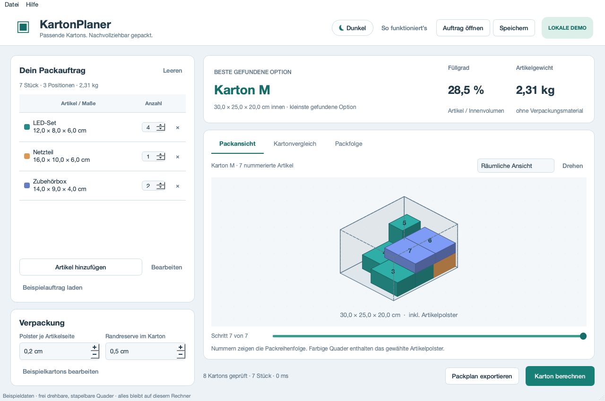
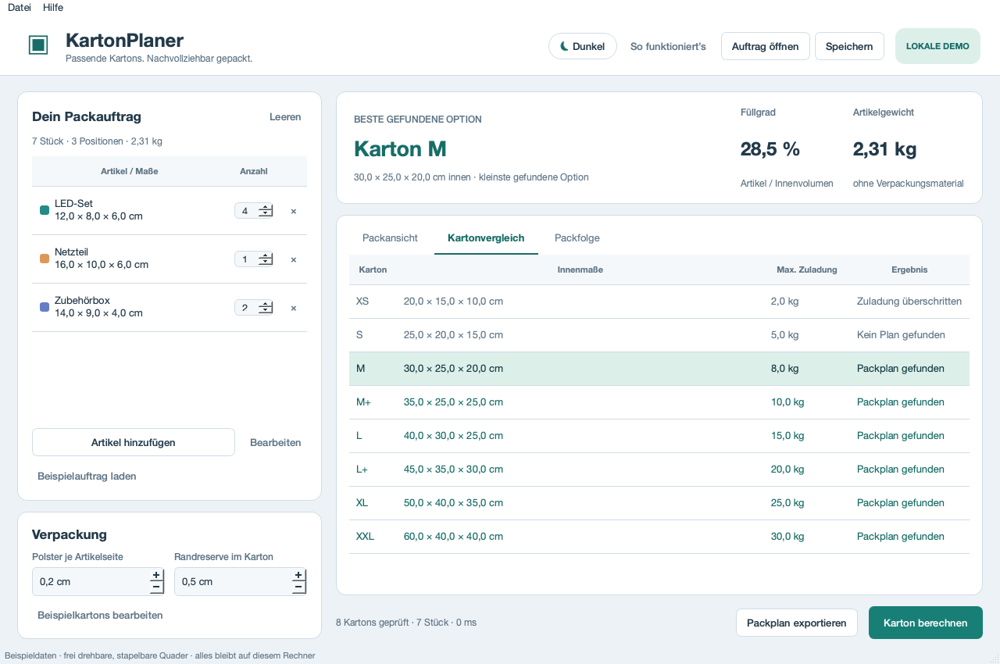
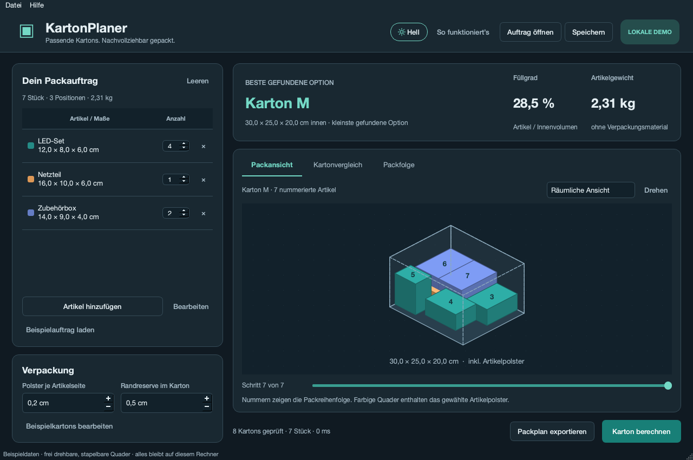

# KartonPlaner

Eine C++-Desktop-App, die für mehrere Artikel einen passenden Versandkarton sucht und die gefundene Anordnung räumlich darstellt.

**[Mac-App herunterladen](https://github.com/trksEnes/kartonplaner-cpp/releases/tag/v1.0.0)** · [Entwicklung und Tests](docs/ENTWICKLUNG.md)

## Die Idee aus dem Lageralltag

Beim Verpacken im Lager stellte sich mir öfter die Frage: Welcher Karton passt zu mehreren Artikeln, ohne unnötig viel Platz zu verschenken? Daraus entstand die Überlegung, die Auswahl mit einem kleinen Programm zu unterstützen.

Der KartonPlaner nimmt Maße, Stückzahlen und Gewicht auf, vergleicht die vorhandenen Kartons und zeigt einen nachvollziehbaren Packvorschlag. Die veröffentlichte Version ist eine eigenständige Demo mit frei gewählten Beispieldaten.

## Was die App kann

- Mehrere unterschiedliche Artikel mit Stückzahlen in einem Karton berücksichtigen.
- Acht anpassbare Beispielkartons nach Innenmaßen und maximaler Artikelzuladung vergleichen.
- Artikel drehen und stapeln; Polster je Artikelseite und Randreserve einplanen.
- Packanordnung räumlich oder von oben ansehen und Schritt für Schritt aufbauen.
- Drehung und Position jedes Artikels in der Packfolge nachvollziehen.
- Aufträge lokal speichern, erneut öffnen und Packpläne als CSV exportieren.
- Zwischen Hell- und Dunkelmodus wechseln; die Einstellung bleibt beim nächsten Start erhalten.

## Wie die Auswahl entsteht

Das Gesamtvolumen allein reicht nicht: Ein langer Artikel kann trotz wenig Volumen zu groß für einen Karton sein. Deshalb prüft die Suche die tatsächlichen Abmessungen, bis zu sechs Drehungen und mehrere Anordnungen. Gestapelte Artikel benötigen eine vollständig unterstützte Grundfläche.

Vor der Ausgabe wird jeder gefundene Packplan separat auf vollständige Stückzahlen, Überschneidungen, Kartongrenzen, Reserven, Gewicht und Packreihenfolge geprüft. Empfohlen wird die **kleinste gefundene Option aus der Kartonliste**.

Die Suche arbeitet heuristisch mit einem begrenzten Suchbudget. Ein fehlender Treffer beweist daher nicht, dass grundsätzlich keine Anordnung möglich ist. Die Demo unterstützt bis zu 80 Einzelartikel. Druckfestigkeit, Schwerpunkt und besondere Behandlung empfindlicher Waren werden nicht berechnet. Die maximale Zuladung meint das Artikelgewicht ohne Karton und Polster. Ein echter Versand benötigt eine praktische Prüfung.

### Kartons vergleichen

### Dunkle Darstellung

## Die App ausprobieren

Die Version [1.0.0](https://github.com/trksEnes/kartonplaner-cpp/releases/tag/v1.0.0) enthält eine gebündelte Mac-App für **Apple Silicon und macOS ab 14**. ZIP-Datei entpacken und die App öffnen. Qt ist im Download enthalten; Python und eine Entwicklungsumgebung werden zum Benutzen nicht benötigt.

Die App ist lokal signiert und nicht von Apple notarisiert. macOS kann den heruntergeladenen Build deshalb mit einem Sicherheitshinweis behandeln. Der Quellcode und die Bauanleitung stehen für einen eigenen Build bereit.

Zum Einstieg ist ein Beispielauftrag geladen. Eigene Artikel lassen sich hinzufügen oder per Doppelklick bearbeiten. Alle Maße werden in Zentimetern, Gewichte in Kilogramm eingegeben. Weitere Beispielaufträge liegen unter [examples/](examples/).

## Umsetzung

**C++20 · Qt 6 Widgets · Qt Concurrent · lokale JSON-Dateien · CSV-Export**

Der Berechnungskern ist unabhängig von Qt und mit C++17 verwendbar. Die Oberfläche berechnet im Hintergrund weiter und bleibt dabei bedienbar. Automatische Prüfungen decken geometrische Grenzfälle, Dateiverarbeitung und Fensterabläufe ab; Einzelheiten und Bauanleitung stehen in der [Entwicklungsdokumentation](docs/ENTWICKLUNG.md).

Bei der Umsetzung wurde KI als Unterstützung in der Entwicklung eingesetzt. Die Packberechnung selbst läuft vollständig lokal.

## Daten und Bibliotheken

Das Projekt enthält keine internen Daten meines Arbeitgebers. Artikel, Kartonmaße und Gewichtsgrenzen sind frei gewählte Beispiele. Es gibt keine Verbindung zu einem Warenwirtschaftssystem, keine Netzwerkübertragung und keine zentrale Datenbank. Auftragsdateien werden auf ausdrücklichen Wunsch lokal gespeichert; die Farbauswahl wird als lokale Programmeinstellung abgelegt.

Hinweise zu den mitgelieferten Bibliotheken und ihren Lizenzen: [THIRD_PARTY_NOTICES.md](THIRD_PARTY_NOTICES.md).
